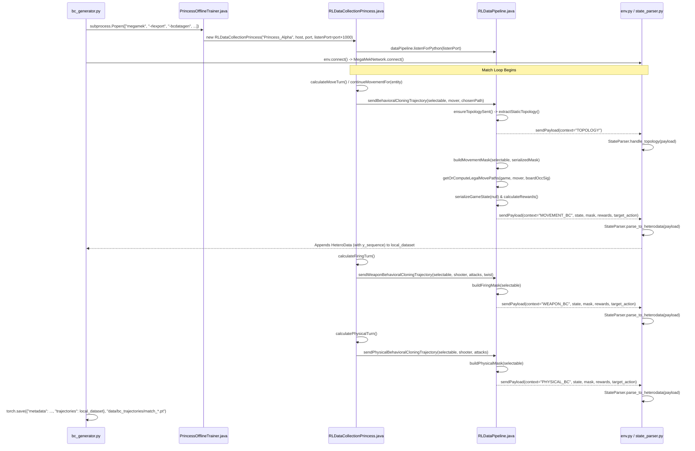
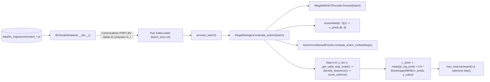
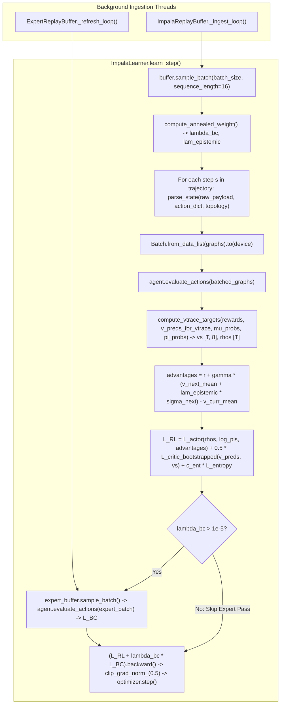

# BattleTech RL AI: System Design & Implementation Reference

## 1. System Architecture Overview

The system implements a decoupled, asynchronous **IMPALA (Importance Weighted Actor-Learner Architecture)** tailored for high-end consumer hardware (e.g., AMD Ryzen 9800X3D CPU + NVIDIA RTX 5090 GPU). Because the Java MegaMek tabletop engine is CPU-intensive (due to $A^*$ pathfinding and line-of-sight geometry), rollout generation is isolated to parallel headless Java servers paired with lightweight CPU Python rollout workers, while backpropagation and batched PyTorch Geometric (PyG) graph evaluations run asynchronously on the GPU learner.

```mermaid
flowchart TD
    subgraph Orchestrator ["self_play_orchestrator.py (Process Manager)"]
        ORCH["main()"]
    end

    subgraph JavaCluster ["Headless MegaMek Servers (JVM Processes)"]
        MM1["PrincessOfflineTrainer (Port 4000)"]
        MM2["PrincessOfflineTrainer (Port 4010)"]
        SAV[("data/midgame_saves/*.sav.gz")]
    end

    subgraph PythonWorkers ["IMPALA Rollout Workers (CPU Processes)"]
        W1["ImpalaWorker (Port 5000)"]
        W2["ImpalaWorker (Port 5001 / 5010)"]
    end

    subgraph DiskIPC ["Filesystem IPC & Buffers"]
        RLBUF[("data/rl_*_trajectories/worker_*/traj_*.pt")]
        EXPBUF[("data/bc_trajectories/match_*.pt")]
        CKPT[("model_objects/impala_agent_latest.pt")]
    end

    subgraph GPULearner ["impala_master.py (GPU Process)"]
        IRB["ImpalaReplayBuffer"]
        ERB["ExpertReplayBuffer"]
        LEARN["ImpalaLearner.learn_step()"]
    end

    ORCH -->|Spawns & Monitors| MM1
    ORCH -->|Spawns & Monitors| MM2
    ORCH -->|Spawns & Monitors| W1
    ORCH -->|Spawns & Monitors| W2
    ORCH -->|Spawns if --run-master| LEARN

    SAV -.->|PSI Load -savegame| MM1
    MM1 -.->|-autoSaveMidGame| SAV

    MM1 <-->|4-Byte Length + MessagePack TCP| W1
    MM2 <-->|4-Byte Length + MessagePack TCP| W2

    W1 -->|Writes 50-step chunks| RLBUF
    W2 -->|Writes 50-step chunks| RLBUF

    RLBUF -->|Ingests & Marks .consumed| IRB
    EXPBUF -->|Loads Teacher-Forced Graphs| ERB

    IRB -->|Batch of Sequences| LEARN
    ERB -->|Expert Batch when lambda_bc > 0| LEARN
    LEARN -->|Saves Atomic Checkpoint| CKPT
    CKPT -.->|sync_weights()| W1
    CKPT -.->|sync_weights()| W2
```

---

## 2. End-to-End Execution Pipelines & Function Call Graphs

This section traces the exact function-by-function call hierarchy across Java and Python for all four operational pipelines.

### 2.1 Pipeline 1: Offline Behavioral Cloning Data Generation (`bc_generator.py`)

In this mode, two modified Princess bots (`RLDataCollectionPrincess`) play full matches against each other while intercepting their own movement, weapon, and physical attack decisions and streaming full state + action-mask + expert-choice payloads to Python.



#### Explicit Function Call Chain (BC Data Generation)
1. **Python Entry (`python-rl/bc_generator.py`):**
   * `__main__` $\to$ `run_single_episode(ep_idx, server_port, ...)`
   * Calls `run_megamek_episode(...)` which spawns `megamek -rlexport -bcdatagen -randomMap -randomBV ... -autoSaveMidGame data/midgame_saves`.
   * Spawns two collection threads: `collect_trajectories(server_port + 1000, ...)` (Player 1) and `collect_trajectories(server_port + 1001, ...)` (Player 2).
2. **Java Server Bootstrap (`PrincessOfflineTrainer.java` & `RLServerManager.java`):**
   * `MegaMek.main()` $\to$ `PrincessOfflineTrainer.runOfflineTraining(args)`
   * Instantiates `Server` on `serverPort`, hooks `RLServerManager.initialize(server)` (which registers a `PhaseChangeListener` on `EventBus`), and spawns `p1 = new RLDataCollectionPrincess("Princess_Alpha", ..., serverPort + 1000)` and `p2 = new RLDataCollectionPrincess("Princess_Beta", ..., serverPort + 1001)`.
3. **Java Turn Interception (`RLDataCollectionPrincess.java` $\to$ `RLDataPipeline.java`):**
   * **Movement Phase:** `RLDataCollectionPrincess.continueMovementFor(Entity)` calls `super.continueMovementFor(entity)` to get Princess's chosen `MovePath`, collects all `e.isSelectableThisTurn()` units, and calls `RLDataPipeline.sendBehavioralCloningTrajectory(selectable, entity, path)`.
   * **Weapon Phase:** `RLDataCollectionPrincess.calculateFiringTurn()` runs `initialize()` + `sendTorsoTwist()`, captures `getEntityToFire()` and ` calculateMyFiringTurn()`, and calls `RLDataPipeline.sendWeaponBehavioralCloningTrajectory(selectable, shooter, actions, chosenTwist)`.
   * **Physical Phase:** `RLDataCollectionPrincess.calculatePhysicalTurn()` calls `super.calculatePhysicalTurn()` to get `PhysicalOption`, converts it to `Vector<EntityAction>`, and calls `RLDataPipeline.sendPhysicalBehavioralCloningTrajectory(selectable, shooter, actions)`.
4. **Java State & Mask Serialization (`RLDataPipeline.java`):**
   * `ensureTopologySent()` $\to$ `extractStaticTopology(board)` $\to$ `sendPayload(topology)` (sent once per match).
   * `buildMovementMask` / `buildFiringMask` / `buildPhysicalMask` + `extractSelectableIndices(selectable)`.
   * `serializeGameState(declaredAttacks)` (reuses round-cached `getOrComputeLegalMovePaths` during Movement phase and skips pathfinding during Firing/Physical phases).
   * `calculateRewards()` (computes `bv1`, `bv2`, `initial_bv1`, `initial_bv2`, `vp1`, `vp2`, `tp1`, `tp2`).
   * `sendPayload(payload)` serializes the map to MessagePack via `MessagePackMapper` with a 4-byte big-endian length header over the loopback socket.
5. **Python Graph Construction (`python-rl/env.py` $\to$ `python-rl/state_parser.py`):**
   * `collect_trajectories` calls `env._receive_payload()`.
   * On `"TOPOLOGY"`, calls `env.state_parser.handle_topology(payload)` (caching `board_width`, `static_hex_features`, and `static_hex_adjacency_edges`).
   * On `"MOVEMENT_BC"`, `"WEAPON_BC"`, `"PHYSICAL_BC"`, calls `env._parse_to_heterodata(payload)` $\to$ `StateParser.parse_to_heterodata(payload)`, which builds the bidirectional HGT graph and Unified Action Tree (`data['action']`) along with the teacher-forcing index sequence `data.y_sequence`.

---

### 2.2 Pipeline 2: Offline Behavioral Cloning Pre-Training (`train_bc.py`)



#### Explicit Function Call Chain (BC Pre-Training)
1. **`train_bc.py: train()`** splits `data/bc_trajectories/*.pt` into 80% train / 20% validation and wraps them in `BCIterableDataset` + PyG `DataLoader`.
2. **`train_bc.py: BCIterableDataset.__iter__()`**:
   * Loads `trajectories` from each match `.pt` file.
   * Reads `data.raw_rewards` (`[bv1, bv2, init_bv1, init_bv2, vp1, vp2, tp1, tp2, current_player_id]`), canonicalizes friendly/enemy BV into a consistent Player-0 reference frame so alternating player turns do not flip `bv1`/`bv2`, computes step rewards $r_t^{(0)}$ and $r_t^{(1)} = -r_t^{(0)}$, and runs an $O(T)$ backward pass to assign discounted Monte Carlo returns `data.y_value = G_t`.
3. **`train_bc.py: process_batch(agent, batch, ...)`**:
   * Calls `MegaMekAgent.evaluate_actions(batch)`:
     1. `MegaMekHGTEncoder.forward(batch)` projects `'hex'`, `'unit'`, and `'weapon'` features, runs 4 layers of `HGTConv` over all 28 directed/reverse edge types, pools `'unit'` and `'weapon'` embeddings via 32 Perceiver latent queries (`self.perceiver_attn`), and concatenates `self.context_mlp(global_context)` to yield $z \in \mathbb{R}^{B \times 4224}$ and `x_dict`.
     2. Evaluates all $E=8$ Critic MLPs (`self.ensembles`) on $z$ to produce `v_preds` ($\in \mathbb{R}^{B \times 8}$), `v_mean`, and `v_variance`.
     3. Calls `ActionConditionedPointer.compute_action_embeddings(x_dict, batch)` (using `hetero_data[node_type].ptr[act_batch]` offsets so every graph in the batch indexes its own hex, unit, and weapon node embeddings).
     4. For each graph $b$ and step $k \in \{0, \dots, y_{\text{len}}-1\}$:
        * Calls `MegaMekAgent._get_valid_step_mask(parent_idx, next_parent_idx, exclusivity_group, chosen_seq_indices)`.
        * Calls `ActionConditionedPointer.decode_sequence(z[b:b+1], history_tensor)` to get $s_k$.
        * Calls `ActionConditionedPointer.score_actions(s_k, e_tier, act_batch_idx_b, x_dict, batch)` to compute pointer cross-attention logits over the valid candidates at step $k$.
        * Accumulates `pi_log_prob_total[b]` and `entropy_total[b]`.
   * Computes `loss_actor = -pi_log_prob_total[mask].mean()` and applies an independent $\text{Bernoulli}(0.63)$ bootstrap mask across `v_preds[mask]` to compute `loss_critic`.

---

### 2.3 Pipeline 3: Live RL Rollouts & Perturbed State Initialization (`self_play_orchestrator.py` & `impala_worker.py`)

```mermaid
sequenceDiagram
    participant ORCH as self_play_orchestrator.py
    participant POT as PrincessOfflineTrainer.java
    participant BOT as RLBotClient.java
    participant RDP as RLDataPipeline.java
    participant WRK as impala_worker.py
    participant ENV as MegaMekEnvironment
    participant AGT as MegaMekAgent

    ORCH->>POT: Spawn MegaMek (-rlexport, -autogen or -selfplay, optional -savegame for PSI)
    POT->>POT: If -savegame: server.loadGame(f) & remap Player names to RL_Agent*
    POT->>BOT: Connect RLBotClient(s) & listenForPython(listenPort)
    ORCH->>WRK: Spawn impala_worker.py (--port listenPort)
    WRK->>WRK: sync_weights() from model_objects/impala_agent_latest.pt
    WRK->>ENV: env.reset()
    BOT->>RDP: changePhase() -> broadcastStartGame()
    BOT->>RDP: calculateMoveTurn() / calculateFiringTurn() / calculatePhysicalTurn()
    RDP-->>ENV: TOPOLOGY (once) + Actionable STATE Payload
    ENV->>ENV: StateParser.parse_to_heterodata(payload)
    ENV-->>WRK: Returns (state_graph, mask, current_payload)
    loop Every Actionable Turn
        WRK->>AGT: get_action(state_graph, mask, deterministic=False)
        AGT->>AGT: encoder(state_graph) -> compute_values(z) -> compute_action_embeddings()
        AGT->>AGT: _sample_agnostic_trajectory() via _get_valid_step_mask()
        AGT->>AGT: _decode_trajectory() -> action_dict
        AGT-->>WRK: Returns (action_dict, v_mean, probs, mu_log_prob)
        WRK->>ENV: env.step(action_dict)
        ENV-->>RDP: MegaMekNetwork.send_action(action_dict)
        RDP-->>BOT: Deserializes RLActionResponse & executes MovePath / Attack / PhysicalOption
        RDP-->>ENV: Next STATE Payload (or GAME_OVER Payload)
        ENV->>ENV: RewardCalculator.compute_reward(payload) (normalized by initial_bv1 + initial_bv2)
        ENV-->>WRK: Returns (next_state, next_mask, done, next_payload)
        WRK->>WRK: Appends transition to trajectory; saves 50-step chunks to disk
    end
```

#### Explicit Function Call Chain (Live RL Rollouts)
1. **Cluster Orchestration (`python-rl/self_play_orchestrator.py`):**
   * `main()` spawns `num_instances` pairs of `megamek_runner` and `python_worker_runner` threads (plus `master_runner` if `--run-master` is passed).
   * In `megamek_runner`: with probability `p_psi` (default `0.25`), selects a random `.sav.gz` snapshot from `data/midgame_saves` and passes `-savegame <path>`.
2. **Java PSI Initialization & Turn Execution (`PrincessOfflineTrainer.java` $\to$ `RLBotClient.java` $\to$ `RLDataPipeline.java`):**
   * If `-savegame` is active, `PrincessOfflineTrainer` calls `server.loadGame(gameFile)` and immediately renames the saved `Player` objects in `server.getGame().getPlayersList()` to `"RL_Agent_Alpha"` / `"RL_Agent_Beta"` (for `-selfplay`) or `"RL_Agent"` / `"Princess_Beta"` (for `-autogen`) before `RLBotClient.connect()` runs, ensuring seamless takeover of mid-game units.
   * On each turn, `BotClient.calculateMyTurnWorker()` invokes `RLBotClient.calculateMoveTurn()` / `continueMovementFor()`, `calculateFiringTurn()`, or `calculatePhysicalTurn()`.
   * `RLBotClient` builds the `RLActionMask` via `RLDataPipeline.buildMovementMask`, `buildFiringMask`, or `buildPhysicalMask` (recording `maskData.selectable_entities`), then calls `RLDataPipeline.queryPython(context, maskData, RLActionResponse.class)`.
   * `RLDataPipeline.queryPython` blocks on `pythonIn.readInt()` until Python returns the MessagePack `RLActionResponse`, which `RLBotClient` translates into a `MovePath`, `Vector<EntityAction>` (including `TorsoTwistAction` and `WeaponAttackAction`s), or `PhysicalOption`.
   * When `game.getPhase() == GamePhase.VICTORY`, `PrincessOfflineTrainer` calls `sendGameOver(p1Won)` on `p1` (and `sendGameOver(p2Won)` on `p2` in `-selfplay` mode).
3. **Python Worker Loop (`python-rl/impala_worker.py` $\to$ `python-rl/models/agent.py`):**
   * `ImpalaWorker.run()` calls `self.sync_weights()` and `self.env.reset()`.
   * At each step, calls `self.agent.get_action(state_graph, mask, deterministic=False)`:
     1. Runs `self.encoder(state_graph)` and `self.actor_pointer.compute_action_embeddings(x_dict, state_graph)`.
     2. Calls `self._sample_agnostic_trajectory(...)`, which loops `self._get_valid_step_mask(...)` and `self._decode_and_sample_step(...)` from Step 0 (`SELECT_UNIT`) until a terminal leaf (`next_parent_idx == -2`) is sampled.
     3. Calls `self._decode_trajectory(state_graph, chosen_seq_indices)` to produce `action_dict` (`{"selected_entity_id": ..., ...}`).
   * Calls `self.env.step(action_dict)` which transmits `action_dict` over TCP, receives the next state, and computes $r_t$ via `RewardCalculator.compute_reward(payload)`.
   * Every 50 steps (and at episode termination), calls `self.save_trajectory_chunk(...)` to write `traj_*.pt` into `data/rl_*_trajectories/<worker_id>/`.

---

### 2.4 Pipeline 4: Asynchronous IMPALA Master Learner (`impala_master.py`)



#### Explicit Function Call Chain (IMPALA Learner)
1. **`ImpalaLearner.run()`** polls `self.learn_step(batch_size=self.batch_size)` and saves checkpoints every 10 steps via `self.save_checkpoint()`.
2. **`ImpalaLearner.learn_step()`**:
   * Calls `self.buffer.sample_batch(batch_size, sequence_length=16)` (Double Coin-Flip sampling: uniform over trajectories, uniform over start step $t_0$).
   * Updates `self.lambda_bc` and `self.lam_epistemic` via `compute_annealed_weight(...)`.
   * For each trajectory in the batch:
     1. Calls `self.parse_state(s["raw_payload"], s.get("action_dict", {}), topology)` for each step $s$. Inside `parse_state`, `self.env.state_parser.handle_topology(topology)` refreshes the trajectory's static board geometry, and `StateParser.parse_to_heterodata` reconstructs the exact `HeteroData` graph and teacher-forcing `y_sequence` corresponding to `action_dict`.
     2. Collates all $T+1$ steps into a single `Batch.from_data_list(graphs)` and runs **one** forward pass: `self.agent.evaluate_actions(batched_graphs)` returning `pi_log_probs`, `entropies_all`, `v_means`, `v_vars`, and `v_preds_all` ($\in \mathbb{R}^{(T+1) \times 8}$).
     3. Calls `self.compute_vtrace_targets(rewards, v_preds_for_vtrace, mu_probs, pi_probs.detach())` to compute per-head V-Trace targets `vs` ($\in \mathbb{R}^{T \times 8}$) and clipped importance ratios `rhos` ($\in \mathbb{R}^T$).
     4. Computes the Actor advantage with the 1-step annealed epistemic bonus:
        `advantages = rewards + gamma * (v_next_mean + self.lam_epistemic * sigma_next) - v_curr_mean`.
     5. Samples a per-trajectory Bernoulli mask `bootstrap_mask` ($\in \{0,1\}^{1 \times 8}, p=0.63$) and computes the masked per-head Critic MSE loss against `vs.detach()`.
   * If `self.lambda_bc > 1e-5`, samples `expert_batch = self.expert_buffer.sample_batch(self.expert_batch_size)` and calls `self.agent.evaluate_actions(expert_batch)` to compute `loss_bc = -pi_log_probs_exp[mask_exp].mean()`.
   * Computes `loss_total = loss_rl + self.lambda_bc * loss_bc`, backpropagates, clips gradients to `0.5`, and steps `Adam`.

---

## 3. Wire-Protocol & PyG Tensor Schema Reference

### 3.1 TCP MessagePack Framing (`RLDataPipeline.java` $\leftrightarrow$ `network.py`)
All socket communication over `127.0.0.1` uses a 4-byte big-endian unsigned integer length header followed by a binary MessagePack payload:
```
+----------------------------+-----------------------------------------+
| 4 Bytes: Payload Length N  | N Bytes: MessagePack Encoded Dictionary |
+----------------------------+-----------------------------------------+
```

### 3.2 PyTorch Geometric `HeteroData` Graph Schema (`StateParser.parse_to_heterodata`)

#### Node Types
| Node Type | Tensor Shape | Description |
| :--- | :--- | :--- |
| `data['hex'].x` | `(N_hex, 14)` | Static terrain features (`x, y, elevation, water, woods, rough, pavement, building, ...`) |
| `data['unit'].x` | `(N_unit, 45)` | Dynamic unit covariates (friendly flag, coords, $\sin/\cos$ facing, heat, armor/structure by location, MP, skills, status flags) |
| `data['weapon'].x` | `(N_weapon, 10)` | Mounted weapon covariates (ranges, damage, operational status, cluster info, ammo/salvos, heat) |
| `data['action'].x` | `(N_act, 12)` | `[one_hot_sub_action_type(8), f_0, f_1, f_2, f_3]` with all continuous features scaled to $[-1, 1]$ |
| `data.global_context` | `(1, 12)` | Normalized phase metadata `[turn/50, round/50, phase, player_id, my_act/12, enemy_act/12, bv1_norm, bv2_norm, vp1, vp2, tp1, tp2]` |
| `data.raw_rewards` | `(1, 9)` | Raw reward metadata `[bv1, bv2, init_bv1, init_bv2, vp1, vp2, tp1, tp2, player_id]` |

#### HGT Edge Types (28 Total: 6 Hex Adjacency + 12 Forward + 10 Reverse)
* **Hex Grid Geometry (6):** `('hex', 'hexAdj_0..5', 'hex')`
* **Spatial Occupancy (2):** `('unit', 'occupies', 'hex')` $\leftrightarrow$ `('hex', 'occupied_by', 'unit')`
* **Equipment Mounting (2):** `('weapon', 'equips', 'unit')` $\leftrightarrow$ `('unit', 'equipped_with', 'weapon')`
* **Reachability by TMM (10):** `('unit', 'moveTypeTMM_0..4', 'hex')` $\leftrightarrow$ `('hex', 'reachableTMM_0..4', 'unit')`
* **Threat & Cover Projections (6):**
  * `('unit', 'movementThreat', 'hex')` $\leftrightarrow$ `('hex', 'threatenedByMove', 'unit')`
  * `('unit', 'LOSThreat', 'hex')` $\leftrightarrow$ `('hex', 'threatenedByLOS', 'unit')`
  * `('unit', 'partialCover', 'hex')` $\leftrightarrow$ `('hex', 'providesCoverAgainst', 'unit')`
* **Directed Combat Declarations & LOS (2):** `('unit', 'LOSTarget', 'unit')`, `('weapon', 'targeted', 'unit')`

#### Unified Action Tree Tensors on `data['action']`
* `parent_idx` (`LongTensor[N_act]`): `-1` for Step-0 `SELECT_UNIT` roots; parent node index for child nodes.
* `next_parent_idx` (`LongTensor[N_act]`): Active `parent_idx` for the next autoregressive step if this node is selected (`-2` for terminal leaves `MOVE_PATH`, `PHYSICAL_ATTACK`, `END_DECLARATION`; parent `TORSO_TWIST` node index for `FIRE_WEAPON`; self `node_idx` for internal nodes).
* `exclusivity_group` (`LongTensor[N_act]`): `weapon_id` ($\ge 0$) for `FIRE_WEAPON` nodes so each weapon can be fired at most once per turn; `-1` for all other nodes.
* `action_type_id` (`LongTensor[N_act]`): Integer sub-action class in `0..7`.
* `raw_meta` (`LongTensor[N_act, 4]`): `[path_index, twist_value, target_entity_index, weapon_or_physical_id]` used by `MegaMekAgent._decode_trajectory`.
* `source_unit_idx`, `target_hex_idx`, `target_unit_idx`, `target_weapon_idx`, `path_idx` (`LongTensor[N_act]`).

---

## 4. Hyperparameter & CLI Reference (`impala_master.py` & `self_play_orchestrator.py`)

| CLI Flag | Default | Description |
| :--- | :--- | :--- |
| `--p-psi` | `0.25` | Probability of launching a rollout worker from a mid-game `.sav.gz` snapshot |
| `--lambda-bc` | `1.0` | Initial weight $\lambda_{\text{BC, init}}$ for supervised BC co-training loss |
| `--lambda-bc-final` | `0.0` | Final weight $\lambda_{\text{BC, final}}$ after decay completes (skips expert buffer when $\le 10^{-5}$) |
| `--bc-warmup-steps` | `500` | Number of learner steps to hold $\lambda_{\text{BC}}$ at `--lambda-bc` while the Critic warms up |
| `--bc-decay-steps` | `5000` | Number of learner steps over which $\lambda_{\text{BC}}$ decays to `--lambda-bc-final` |
| `--bc-schedule` | `"cosine"` | Annealing curve for $\lambda_{\text{BC}}$ (`"cosine"`, `"linear"`, or `"exponential"`) |
| `--lam-epistemic` | `0.5` | Initial weight $\lambda_{\text{epistemic, init}}$ for the Actor's 1-step epistemic uncertainty bonus |
| `--lam-epistemic-final` | `0.0` | Final weight $\lambda_{\text{epistemic, final}}$ after `--epistemic-decay-steps` |
| `--epistemic-decay-steps` | `10000` | Number of learner steps over which $\lambda_{\text{epistemic}}$ linearly decays |
| `--max-hours` | `0.0` | Optional runtime limit in hours before ordered graceful shutdown (`0.0` = unlimited) |
| `--cleanup-orphans` | `False` | Sweeps and terminates any lingering headless MegaMek or IMPALA worker processes |

---

## 5. Step-Level Game Report Streaming, Visualization & Graceful Lifecycle

### 5.1 Step-Synced MegaMek Combat & Phase Report Capture
* **`RLBotClient.receiveReport` & `RLDataCollectionPrincess.receiveReport`:** Call `super.receiveReport(reports)` to format incoming `PACKET_PHASE_REPORT` / `PACKET_PARTIAL_PHASE_REPORT` packets through MegaMek's `ReportMessages` bundle, and push the resulting text into `RLDataPipeline.appendReports(formatted)`.
* **Intra-Phase Action & Phase Markers:** `changePhase`, `calculateMoveTurn`, and `calculateFiringTurn` append concise `[Move]`, `[Weapon Decl]`, and `=== Round R | Phase: P ===` markers via `RLDataPipeline.appendReportLine(...)`.
* **Step-Level Payload Drain:** Every outgoing MessagePack payload (`queryPython`, `sendBehavioralCloningTrajectory`, `sendWeaponBehavioralCloningTrajectory`, `sendPhysicalBehavioralCloningTrajectory`, and `sendGameOver`) calls `payload.put("reports", drainReports())`, attaching the exact sequence of events that occurred since the previous decision step.

### 5.2 Trajectory Inspection & Live Web Debugging Tools
* **CLI Trajectory Inspector (`python-rl/inspect_gamelog.py` / `python-rl/validations/inspect_gamelog.py`):**
  * Inspects `.pt` files (both RL trajectory chunks and BC match files), printing step-by-step round/turn, selected unit, action summary, step/cumulative rewards, value predictions, and captured MegaMek combat reports.
  * Pass `--render render.html` to automatically generate the interactive HTML board visualization.
* **Interactive HTML Trajectory Renderer (`python-rl/validations/render_game_state.py`):**
  * Renders any list of `.pt` trajectory chunks into a standalone interactive HTML viewer with hex grid, unit facing/armor/heat inspector, TMM/threat/LOS edge toggles, and a **Step Reports vs. Full Match Log** toggle.
* **Live Interactive Web Debugger (`python-rl/validations/interactive_debugger.py`):**
  * Connects a Flask UI (`http://localhost:5000`) to a live MegaMek RL match.
  * Calls `MegaMekAgent.compute_ui_action_probabilities(state_graph, mask)` to annotate every candidate in the Unified Action Tree (`SELECT_UNIT` $\to$ `MOVE_HEX` $\to$ `MOVE_PATH`, or `SELECT_UNIT` $\to$ `TORSO_TWIST` $\to$ `SELECT_TARGET` $\to$ `FIRE_WEAPON`) with exact step and joint probabilities.
  * Pass `--spawn-server` (`python python-rl/validations/interactive_debugger.py --spawn-server`) to automatically launch a self-contained headless MegaMek match and attach the web debugger in a single command.

### 5.3 Ordered 3-Phase Graceful Shutdown & State Preservation
1. **POSIX Process-Group Isolation (`start_new_session=True`):** All headless MegaMek server instances (`build/install/MegaMek/bin/megamek`) and workers are spawned in dedicated process groups and terminated via `os.killpg(pgid, signal.SIGTERM)` (with `SIGKILL` fallback), preventing orphaned child JVMs.
2. **Ordered 3-Phase Shutdown (`self_play_orchestrator.py`):**
   * **Phase 1 (Workers):** Signals `impala_worker.py` (`SIGTERM`), setting `worker.stop_requested = True` so each worker breaks out of its rollout loop and atomically writes (`traj_*.pt.tmp` $\to$ `traj_*.pt`) its remaining in-flight trajectory steps to disk.
   * **Phase 2 (MegaMek JVMs):** Terminates all MegaMek server process groups via `terminate_process_group`.
   * **Phase 3 (IMPALA Master):** Signals `impala_master.py` (`SIGTERM`), setting `learner.stop_requested = True` so it completes its active `learn_step()`, atomically saves `model_state_dict`, `optimizer_state_dict`, `global_step`, `lambda_bc`, and `lam_epistemic` to `model_objects/impala_agent_latest.pt`, and preserves all unconsumed `.pt` trajectory files on disk for seamless resumption.
